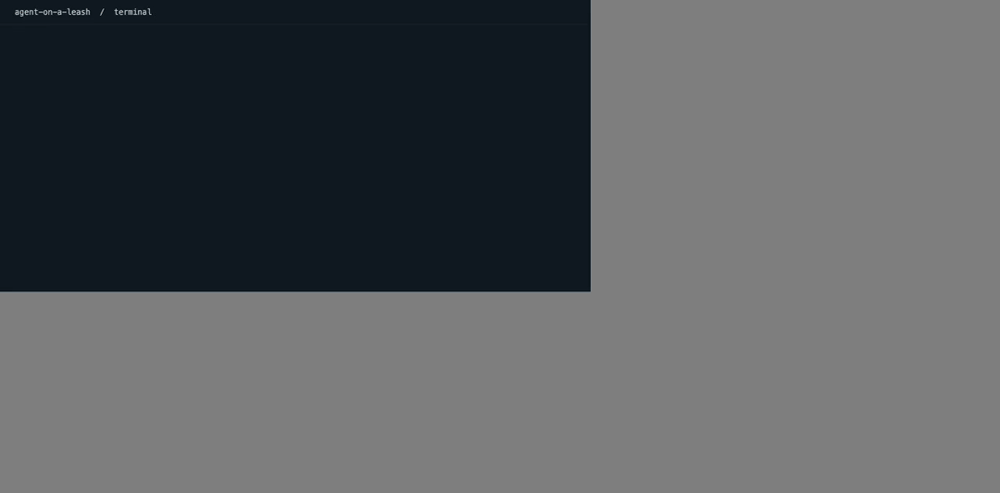
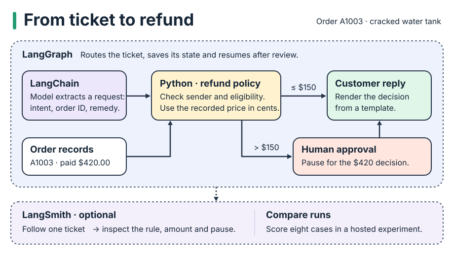

  <h1>Agent on a Leash</h1>
  
A support agent for damaged orders. Python reads the price from the order record. A person reviews refunds over $150.

  

    
    
    
    
  

## Run the demo

With uv or Python 3.11+, run `make setup && make demo`. Watch the $420 refund pause for review before the customer sees an approved amount.

## System design

## Follow one ticket

| Library | Where it applies |
| --- | --- |
| [LangChain](src/classifier.py) | Turns “A1003 arrived cracked” into a validated damage report. The offline demo uses rules for this step. |
| [LangGraph](src/graph.py) | Looks up A1003 and runs the refund policy. At $420 it saves the thread, waits for a reviewer, then resumes to send the reply. |
| [LangSmith](evals/run_langsmith.py) | Shows which rule fired in a ticket trace. Its hosted experiment scores the same eight cases as the local eval. |

## How it's evaluated

| Layer | What it checks | Run |
| --- | --- | --- |
| [Unit tests](tests) | Policy boundaries ($150.00 vs $150.01, day 30 vs 31) and the judge wiring, offline | `make test` |
| [Offline evals](evals/evaluators.py) | 8 tickets × 5 exact checks: decision, amount, pause, rule ids and reply safety | `make eval` |
| [LLM-as-judge](evals/judge.py) | A second model grades every reply against a short rubric. First it must fail 3 planted bad replies, or its scores don't count | `make eval-judge` (needs a model key) |
| [LangSmith](evals/run_langsmith.py) | The same evaluators as a hosted experiment, next to the traces | `make eval-langsmith` |

Exact checks own the facts: the decision, the money and the pause. The judge only grades wording, which code can't check well. `make check` runs lint, types, tests and the offline evals with no network.

## Try it yourself

Try `make chat` as `ana@example.com` with **“A1003 arrived cracked. Refund please.”** Run `make check` for lint, types, tests and all eight eval cases.

For a live model, copy `.env.example` to `.env`, set `CLASSIFIER=llm` and supply your provider key. Enable `LANGSMITH_TRACING=true` with a LangSmith key to see traces. [Configuration](.env.example)
